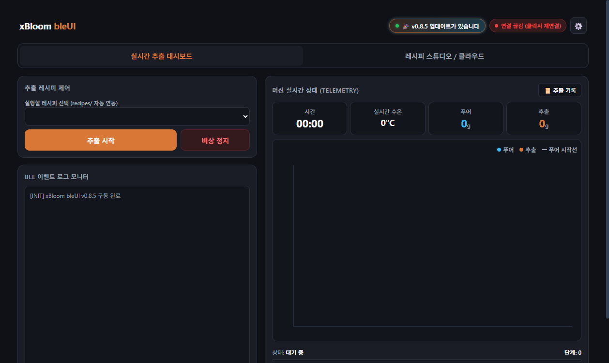
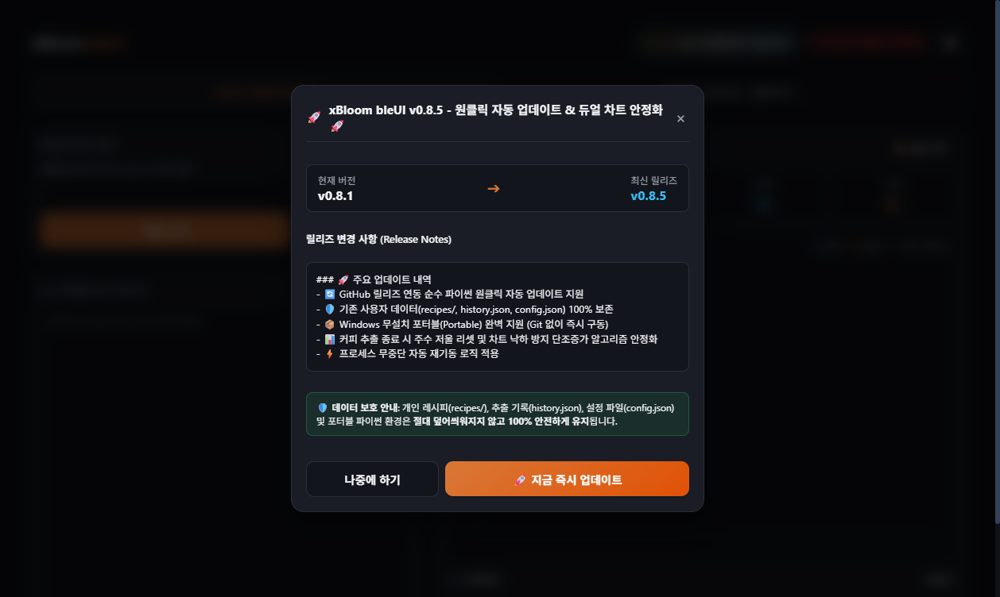

# xBloom bleUI (v0.8.5)

<p align="center">
  <strong>xBloom Studio 커피 머신을 위한 모던 로컬 웹 대시보드 & 실시간 추출 분석 컨트롤러</strong>
</p>

<p align="center">
  
  
  
  
  
</p>

<p align="center">
  
  <br>
  <em>실시간 물 투입량(Water Pour)과 컵 추출액(Coffee Yield) 듀얼 그래프 & 스마트 유속 감지 푸어 마커</em>
</p>

---

## ☕ 프로젝트 소개

**xBloom bleUI**는 프리미엄 올인원 커피 머신인 **xBloom Studio**를 블루투스(Bluetooth LE)로 연결하여, PC나 태블릿, 스마트폰의 웹 브라우저를 통해 원격으로 레시피를 제어하고 실시간 추출 데이터(수온, 주수량, 추출액, 추출 비율)를 듀얼 그래프로 시각화해주는 차세대 로컬 웹 시스템입니다.

기존 공식 모바일 앱의 제약(수동 인터벌 계산, 공유 링크 파싱 부재, 분쇄-추출 미분리 등)을 보완하고, 사용자가 원하는 완벽한 커피 추출 경험을 지원합니다.

---

## 👥 기여자 및 크레딧 (Contributors & Credits)

본 프로젝트는 오픈소스 커뮤니티의 나눔과 기여를 기반으로 발전하고 있습니다.

| 프로필 | 기여자 | 기여 및 역할 |
| :---: | :---: | :--- |
| <a href="https://github.com/Janczykkkko"></a> | **[Janczykkkko](https://github.com/Janczykkkko)**<br>*(Original Author)* | • 원본 **[xbloom-ble](https://github.com/Janczykkkko/xbloom-ble)** 프로젝트 저작자<br>• xBloom Studio 블루투스(BLE) 통신 프로토콜 리버스 엔지니어링 및 코어 패킷 디코더 설계<br>• 머신 통신 프레임워크 및 기기 물리 슬롯 제어 기반 구축 |
| <a href="https://github.com/ennemate"></a> | **[ennemate (xBloom bleUI Contributors)](https://github.com/ennemate/xBloom-bleUI)** | • **xBloom bleUI** 로컬 웹 대시보드 기획 및 풀스택 아키텍처 설계<br>• 순수 파이썬 기반 GitHub 연동 원클릭 자동 업데이트 시스템 구현<br>• 실시간 듀얼 추출 차트(Chart.js) & 스마트 유속 감지 푸어 마커 알고리즘<br>• 원두 분쇄(Grind)와 추출(Brew) 2단계 분리 및 타이머 동기화<br>• 핸드드립 누적 인터벌 보정 & 이중 적용 방지 시스템<br>• xBloom 공식 클라우드 양방향 연동 & 웹 공유 링크 자동 발급/파싱<br>• 영구 추출 히스토리 아카이브 및 Windows 포터블 무설치판 패키징 |

> [!NOTE]
> 훌륭한 BLE 프로토콜 기반과 코어 통신 라이브러리를 오픈소스로 공유하여 본 프로젝트의 토대를 마련해 주신 **Janczykkkko** 님께 깊은 감사를 표합니다.

---

## ⚡ 원본(`xbloom-ble`)과의 차이점 및 핵심 개선 사항

| 비교 항목 | 원본 프로젝트 (`xbloom-ble`) | **xBloom bleUI (본 프로젝트)** |
| :--- | :--- | :--- |
| **자동 업데이트** | 수동 git pull 또는 재설치 | **GitHub 릴리즈 연동 원클릭 자동 업데이트 (사용자 데이터 100% 무손실 보존)** |
| **인터페이스 (UI)** | 터미널 기반 CLI 및 TUI (Textual) | **모던 반응형 웹 대시보드 (다크/라이트, 커스텀 배경, Zero-Jank)** |
| **추출 시점 동기화** | 커밋 즉시 시간 카운트 (분쇄 중 시간 누적) | **원두 분쇄(Grind)와 실제 물 투입(Brew) 2단계 분리 (00:00 완벽 동기화)** |
| **푸어 구간 감지** | 단순 고정 시간 경과 기준 | **스마트 유속/저울 감지 (Smart Flow Detection) 실시간 핀 배지 마커** |
| **핸드드립 인터벌** | 머신 단순 대기(`wait`)만 지원 | **총 경과 시간 기준 인터벌 오버헤드 자동 계산 & 이중 적용 방지** |
| **클라우드 연동** | 단방향 레시피 푸시 | **양방향 연동 + 웹 공유 URL 발급 + 외부 공유 링크 자동 파싱 임포트** |
| **분쇄 OFF 규격** | 분쇄도 0 처리 시 일부 펌웨어 오류 가능성 | **공식 앱 규격 준수 (`isSetGrinderSize: 2`, 분쇄 OFF 정상 표기)** |
| **기기 메모리 슬롯** | CLI 슬롯 저장 | **A / B / C 물리 버튼 원터치 원격 슬롯 프로그래밍** |
| **추출 데이터 보관** | 세션 종료 시 차트 소멸 | **영구 로컬 히스토리 아카이빙, 듀얼 차트 복원, 원클릭 재추출(Re-brew)** |

---

### 1. 원두 분쇄(Grind) 단계와 실제 물 투입(Brew) 시점의 2단계 분리
- **기존 문제**: 내장 그라인더가 켜진 레시피를 실행하면 머신이 원두를 분쇄하는 약 20~25초 동안에도 타이머가 흘러가고, 차트에 저울 0g 수평선이 길게 생기며 1차 푸어가 분쇄 시작 시점에 찍히는 현상이 있었습니다.
- **bleUI 개선**: 머신의 `STARTING (0x22)` 분쇄 상태를 감지하여 상태창에 **`원두 분쇄 중 (Grind ⚙️)`**을 유지하고, 분쇄가 끝난 뒤 머신이 실제로 물을 분사하거나 `BREWING`으로 전환되는 첫 순간에 **정확히 `00:00` 타이머와 1차 푸어 마커를 동기화**합니다.

### 2. 스마트 유속/저울 푸어 마커 (Smart Flow Detection)
- 가열 시간 지연이나 추출 전 교반(`agitation_before`)이 포함되어 물이 늦게 떨어지더라도, 실제 저울의 물 투입 무게(`pour_weight >= 0.8g`)가 증가하는 순간을 실시간 감지하여 1차 푸어 마커를 정확한 시점에 자동 보정합니다.
- 2차, 3차 이후 푸어도 저울의 수평 플래토(Plateau) 이후 새롭게 물이 쏟아져 나오는 순간을 감지하여 차트 위에 세련된 수직 점선과 핀 배지(`1차 00:00`, `2차 00:40`...)로 표시합니다.

### 3. 핸드드립 인터벌 보정 & 이중 적용 방지
- 핸드드립 레시피의 "0초 1차, 40초 2차, 1분 10초 3차"와 같은 누적 시간 인터벌을 xBloom 머신 규격에 맞게 변환합니다. 푸어 시간과 교반 오버헤드를 자동으로 계산하여 실제 머신 대기시간(`wait`)으로 변환합니다.
- 저장 시에는 머신 대기시간으로 완벽히 보정된 값만 파일에 저장하고 인터벌 옵션 상태를 자동 해제하여, **레시피를 다시 불러올 때 대기시간이 중복 차감되는 참사를 원천 차단**했습니다.

### 4. xBloom 공식 클라우드 양방향 연동 & 웹 공유 링크 자동 파싱
- **공식 앱 계정 연동**: 이메일/비밀번호로 로그인하여 클라우드에 나만의 커스텀 레시피를 바로 등록할 수 있습니다.
- **웹 공유 링크 즉시 발급**: 업로드 완료 시 xBloom 웹 공유 링크(`https://share-h5.xbloom.com/?id=...`)를 자동으로 받아와 새 탭에서 바로 띄워주며 클립보드 복사를 지원합니다.
- **공유 링크 원클릭 임포트**: 다른 사용자가 공유한 URL이나 ID만 입력하면 이름, 원두량, 분쇄도, RPM, 모든 푸어 단계(온도, 용량, 유속, 패턴, 교반)를 완벽하게 파싱하여 레시피 스튜디오로 가져옵니다.
- **분쇄 OFF(Pre-ground) 완벽 지원**: 분쇄를 끈 레시피 업로드 시 공식 앱 규격(`isSetGrinderSize: 2`)을 엄격히 적용하여, 클라우드 웹페이지에서 분쇄도 0이 아닌 "분쇄 OFF"로 완벽하게 렌더링됩니다.

---

## 🌟 주요 화면 및 상세 기능 안내

### 1. 📊 실시간 추출 대시보드
<p align="center">
  
</p>

- **실시간 수온 / 시간 / 주수량 / 추출액 4대 메트릭 실시간 표시**: 머신 텔레메트리 패킷을 웹소켓으로 0.1초 단위 즉시 수신.
- **듀얼 실시간 차트**: 물 투입량(Water Pour)과 컵 추출액(Coffee Yield)을 초 단위로 기록하며, 부드러운 스플라인(Spline) 곡선 스무딩을 지원합니다.
- **추출 비율 자동 계산**: 실시간 주수량과 투입 원두량(Dose)을 기반으로 현재 추출 비율(예: `1 : 16.0`)을 실시간 갱신합니다.
- **비상 정지 안전 시스템**: 이상 감지 시 클릭 한 번으로 머신 동작을 즉시 멈추고 안전하게 연결을 보존합니다.

---

### 2. 🎛️ 레시피 스튜디오 (Recipe Studio)
<p align="center">
  
</p>

- **정밀 그라인더 제어**: 분쇄도(10~100) 및 모터 회전 속도(60~120 RPM, 10단위) 제어 지원.
- **다양한 푸어 패턴**: Center(중앙), Ring(원형), Spiral(나선형) 패턴 완벽 지원.
- **스마트 교반(Agitation)**: 푸어 전 원두 평탄화 교반(`agitation_before`) 및 푸어 후 교반(`agitation_after`) 독립 설정.
- **핸드드립 인터벌 동기화 뱃지**: 목표 대기시간 대비 주수 오버헤드를 뺀 실제 기기 대기시간을 카드에 실시간 힌트로 표시.
- **YAML 표준 호환**: 로컬 PC 파일로 내보내기 및 가져오기 완벽 지원.

---

### 3. 📋 저장된 레시피 관리 & 머신 슬롯 프리셋
<p align="center">
  
</p>

- 서버 로컬 폴더(`recipes/`)에 저장된 레시피 목록을 검색하고, 즉시 불러오거나 불필요한 레시피를 영구 삭제할 수 있습니다.
- 머신 상단의 **A, B, C 물리 버튼**에 원하는 레시피를 원격으로 즉시 플래시 메모리에 프로그래밍합니다.

---

### 4. ☁️ xBloom 클라우드 연동 & 공유 링크 자동 발급
<p align="center">
  
</p>

- 공식 앱 계정 로그인 후 클릭 한 번으로 나만의 레시피를 xBloom 클라우드에 업로드합니다.
- 업로드 즉시 공식 웹 공유 링크(`https://share-h5.xbloom.com/?id=...`)를 자동 획득하여 새 탭에서 열어보거나 복사할 수 있습니다.
- 타인이 웹에서 공유한 레시피 URL을 붙여넣으면 즉시 레시피 스튜디오로 불러옵니다.

---

### 5. 📜 영구 추출 히스토리 & 그래프 아카이브
<p align="center">
  
</p>

- 완료된 추출뿐만 아니라 비상 정지된 추출 데이터까지 로컬 스토리지에 영구 보존합니다.
- 과거 추출 기록을 클릭하면 당시의 푸어선, 추출선, 푸어 마커, 총 소요시간, 추출 비율을 완벽 복원하여 열람할 수 있으며, **[⚡ 이 레시피 스튜디오로 불러오기]** 버튼으로 원클릭 재추출(Re-brew)할 수 있습니다.

---

### 6. 🚀 순수 파이썬 원클릭 자동 업데이트 (Auto-Update)

새로운 버전이 GitHub 릴리즈에 등록되면, 웹 화면 상단에 자동으로 알림 뱃지가 표시되며 클릭 한 번으로 안전하게 최신 버전으로 업데이트할 수 있습니다.

<p align="center">
  
  <br>
  <em>헤더 우측의 새 업데이트 알림 펄스 뱃지 (비동기 감지로 실행 지연 0초)</em>
</p>

<p align="center">
  
  <br>
  <em>릴리즈 노트 열람 및 데이터 무손실 원클릭 업데이트 모달</em>
</p>

- **포터블 환경 100% 자립 동작**: Git이 설치되어 있지 않은 일반 사용자 및 Windows 포터블 무설치판 환경에서도 파이썬 표준 라이브러리(`urllib`, `zipfile`, `shutil`)만으로 안전하게 업데이트됩니다.
- **실행 지연 0초 & 오프라인 완벽 대응**: 서버 기동을 가로막지 않고 페이지 로드 후 백그라운드에서 비동기 확인하며, 12시간 스마트 캐시를 통해 불필요한 네트워크 요청을 방지합니다. 오프라인 상태에서도 오류 없이 조용히 넘어갑니다.
- **사용자 데이터 100% 보존**: 업데이트 시 소스 코드만 선별 덮어쓰기되므로, 사용자의 개인 레시피(`recipes/`), 과거 추출 기록(`history.json`), 개인 설정(`config.json`) 및 포터블 파이썬 환경(`python/`)은 **절대 지워지지 않고 온전히 유지**됩니다.
- **원클릭 자동 재기동**: [지금 즉시 업데이트] 클릭 시 최신 패키지를 내려받아 교체한 후 서버 프로세스가 자동으로 재시작되며 브라우저 화면이 새로고침됩니다.
- **수동 확인 지원**: 우측 상단 설정(⚙️) 모달 내 **[업데이트 확인]** 버튼으로 언제든 즉시 최신 버전을 확인할 수 있습니다.

---

## 📦 다운로드 및 배포 버전 (Download & Releases)

사용 환경에 맞게 두 가지 배포판 중 하나를 선택하여 다운로드할 수 있습니다:

| 배포판 | 대상 및 권장 환경 | 다운로드 링크 |
| :--- | :--- | :--- |
| **🚀 Windows 포터블 무설치판**<br>*(Standalone Portable)* | **파이썬 설치가 번거롭거나 어려운 일반 사용자 추천**<br>• Python 3.10 임베디드(Embedded) 런타임 및 필수 라이브러리 일체 내장<br>• 시스템 파이썬 설치/환경변수 설정 불필요<br>• 압축 풀고 `run.bat` 더블 클릭 즉시 구동 | [⬇️ 최신 포터블 릴리즈 다운로드 (Releases)](https://github.com/ennemate/xBloom-bleUI/releases) |
| **💻 일반 소스 배포판**<br>*(Standard / Cross-platform)* | **Windows, macOS, Linux 크로스플랫폼 지원**<br>• 이미 시스템에 Python 3.10 이상이 설치된 사용자/개발자<br>• `git clone` 또는 Source Code ZIP 다운로드 후 직접 구동 | [⬇️ Source Code (ZIP / tar.gz)](https://github.com/ennemate/xBloom-bleUI/releases) |

---

## 🚀 빠른 시작 (Installation & Running)

### 시스템 요구사항
- **OS**: Windows 10/11, macOS, Linux
- **Bluetooth**: Bluetooth 4.2 / 5.0 이상 지원 블루투스 어댑터
- **머신**: xBloom Studio 전원이 켜져 있고 주변에 위치해야 함
- **Python**: 일반 소스 배포판의 경우 Python 3.10+ 필요 *(포터블판은 파이썬 불필요)*

---

### 방법 A. Windows 포터블 무설치판 실행 (가장 추천)
1. [Releases 페이지](https://github.com/ennemate/xBloom-bleUI/releases)에서 `xBloom-bleUI-v0.8.5-Windows-Portable.zip` 다운로드
2. 원하는 폴더에 압축 해제
3. 폴더 안의 **`run.bat`** 파일을 더블 클릭
   - 내장된 임베디드 파이썬 환경으로 서버가 자동 구동되며, 기본 웹 브라우저(`http://localhost:8000`)가 즉시 열립니다.

---

### 방법 B. 일반 배포판 소스 실행 (Windows / macOS / Linux)
1. 저장소 클론 또는 소스코드 다운로드:
   ```bash
   git clone https://github.com/ennemate/xBloom-bleUI.git
   cd xBloom-bleUI
   ```
2. 필수 의존성 패키지 설치:
   ```bash
   pip install -r requirements.txt
   ```
3. 웹 서버 실행 (브라우저 자동 오픈):
   ```bash
   # 런처 스크립트 실행 (브라우저 자동 열림)
   python run.py

   # 또는 직접 uvicorn 서버 구동
   python server.py --host 0.0.0.0 --port 8000
   ```
4. 웹 브라우저에서 `http://localhost:8000` 접속

---

### 🔄 버전 업데이트 및 사용자 데이터 보존 안내 (Data Safe Update)

- **원클릭 자동 업데이트**: 웹 화면 상단의 업데이트 알림 뱃지 또는 설정(⚙️)의 [업데이트 확인]을 통해 마우스 클릭 한 번으로 안전하게 최신 버전으로 업그레이드할 수 있습니다.
- **수동 덮어쓰기 업데이트 지원**:
  - 새 버전의 파일들(`server.py`, `run.bat`, `run.py`, `static/`, `xbloom_ble/`)을 기존 폴더에 그대로 덮어쓰기 하셔도, 배포 패키지에는 유저 데이터 파일(`history.json`, `config.json`)이 포함되어 있지 않으므로(설정은 `config.example.json` 제공), **기존의 추출 기록과 사용자 설정(로그인, 테마, 배경화면 등), 레시피가 절대 덮어씌워지지 않고 100% 보존**됩니다.
- **3중 데이터 안전망 (Triple Safety Net)**:
  1. **`.bak` 자동 백업**: 서버 기동 시 `history.json.bak` 및 `config.json.bak` 사본을 자동 생성하여 손상을 방지합니다.
  2. **브라우저 로컬 스마트 동기화**: 브라우저 캐시와 서버 기록을 비교하여, 서버 기록이 비어있더라도 브라우저에서 서버로 즉시 자동 복원합니다.
  3. **단조 증가(Peak) 주수량 보호**: 머신 추출 종료 시 주수 저울이 0g으로 리셋되어도 최종 투입량(Water Pour)이 0으로 떨어지지 않고 정상 보존됩니다.

---

### ⚙️ 포트 번호 변경 (Port Customization)
기본 포트는 `8000`이며, 다른 프로그램과 포트가 충돌하거나 원하는 포트로 변경하고 싶다면 아래 방법 중 하나를 사용할 수 있습니다:

- **Windows (`run.bat`)**:
  - 방법 1 (간편): CMD나 터미널에서 포트 번호를 인자로 실행 ➔ `run.bat 8080`
  - 방법 2 (고정): 메모장으로 `run.bat`을 열어 상단의 `set PORT=8080`으로 수정한 뒤 더블 클릭
- **Python 런처 (`run.py`)**:
  - `python run.py 8080`  (또는 `python run.py -p 8080`, `python run.py --port 8080`)
- **서버 직접 실행 (`server.py`)**:
  - `python server.py --port 8080`
- **스마트폰/태블릿 등 외부 기기 접속**:
  - 서버는 기본적으로 `0.0.0.0` 호스트로 바인딩되므로, 동일한 Wi-Fi에 연결된 스마트폰이나 태블릿에서 `http://<PC의 로컬 IP 주소>:<포트>` (예: `http://192.168.0.15:8000`)로 접속하여 실시간 추출 대시보드를 사용할 수 있습니다.

---

## 📁 배포 패키지 디렉터리 구조

```text
xBloom-bleUI/
├── run.bat               # Windows 원클릭 실행 배치 파일 (포트 커스텀 지원)
├── run.py                # Python 크로스플랫폼 자동 브라우저 오픈 런처
├── server.py             # 경량화/최적화된 FastAPI 백엔드 서버 (v0.8.5)
├── requirements.txt      # 실행 필수 의존성 목록
├── config.example.json   # 기본 설정 참고용 템플릿 (기존 설정 덮어쓰기 방지)
├── README.md             # 프로젝트 상세 안내 문서 (이미지 포함)
├── docs/
│   └── img/              # 대시보드 및 주요 기능 데모 스크린샷 이미지
│       ├── dashboard-chart.png
│       ├── recipe-studio.png
│       ├── server-recipes.png
│       ├── cloud-share.png
│       ├── brew-history.png
│       ├── auto-update-badge.png
│       └── auto-update-modal.png
├── static/
│   └── index.html        # 단일 페이지 모던 웹 프론트엔드
├── recipes/              # 로컬 저장 기본 레시피 및 슬롯 프리셋 보관소
│   ├── example-iced.yaml
│   ├── example-natural.yaml
│   ├── example-washed.yaml
│   └── slots/
│       ├── slot_1.json
│       ├── slot_2.json
│       └── slot_3.json
└── xbloom_ble/           # BLE 통신 및 제어 핵심 모듈
    ├── __init__.py
    ├── client.py
    ├── cloud.py
    ├── config.py
    ├── paths.py
    ├── protocol.py
    ├── recipe.py
    └── telemetry.py
```

---

## 📄 라이선스 (License)

본 프로젝트는 [MIT License](LICENSE)를 따릅니다.

```text
MIT License

Copyright (c) 2024 Janczykkkko (Original xbloom-ble)
Copyright (c) 2026 xBloom bleUI Contributors (https://github.com/ennemate/xBloom-bleUI)
```

## ⚠️ 면책 조항 (Disclaimer)

- 본 소프트웨어는 개인이 취미 및 연구 목적으로 개발한 **비공식(Unofficial) 오픈소스 프로젝트**이며, TBDx Inc.(xBloom) 공식 소프트웨어가 아닙니다.
- 커피 머신 제어 시 고온의 온수가 배출되므로, 머신에 물과 컵이 올바르게 준비되어 있는지 항상 안전을 확인한 후 추출을 진행해 주시기 바랍니다.
