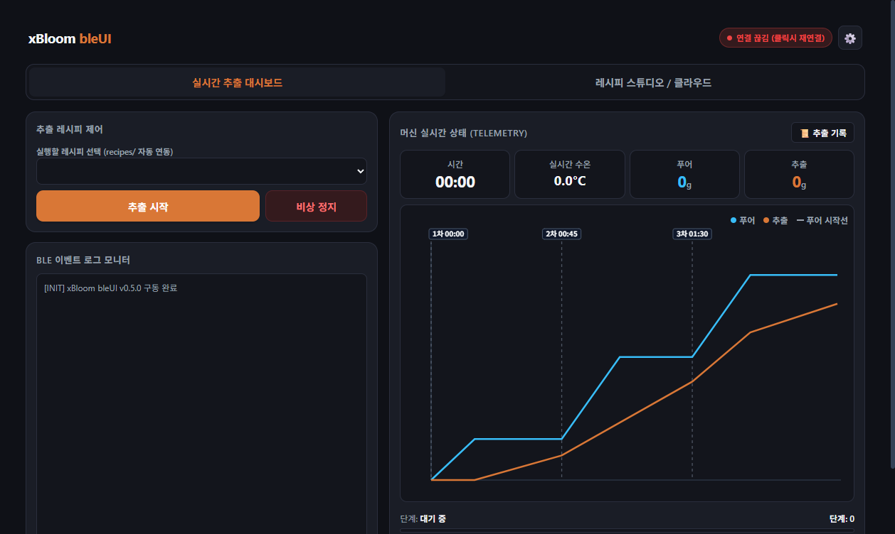
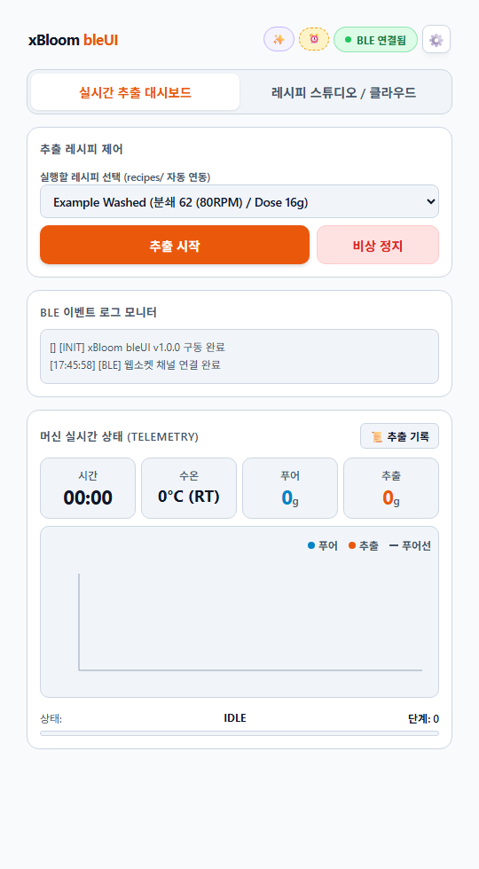
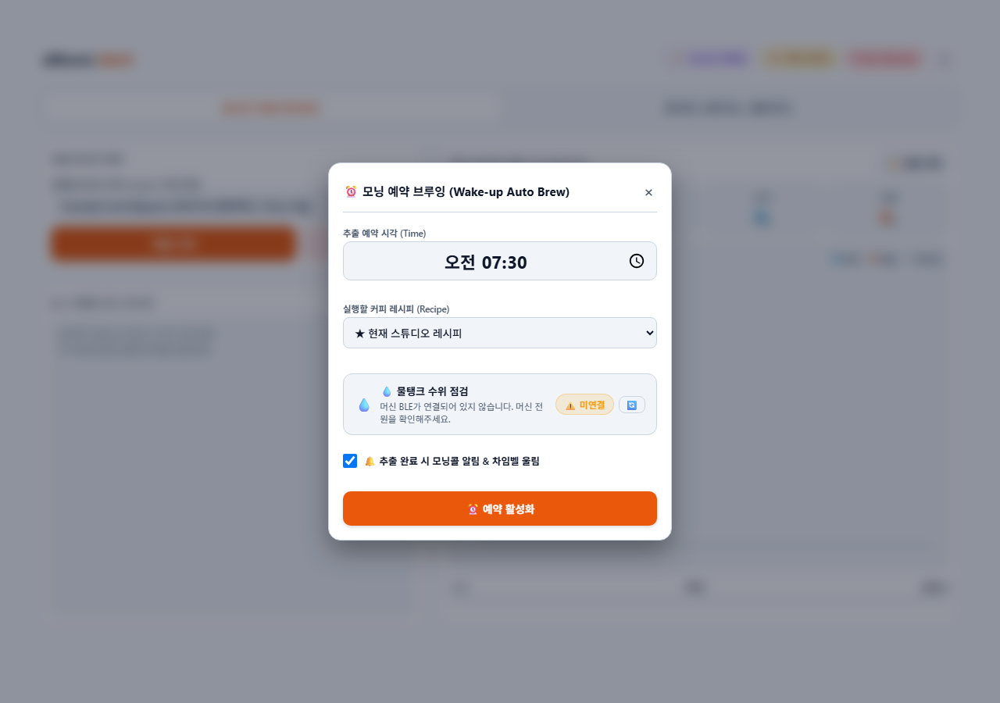
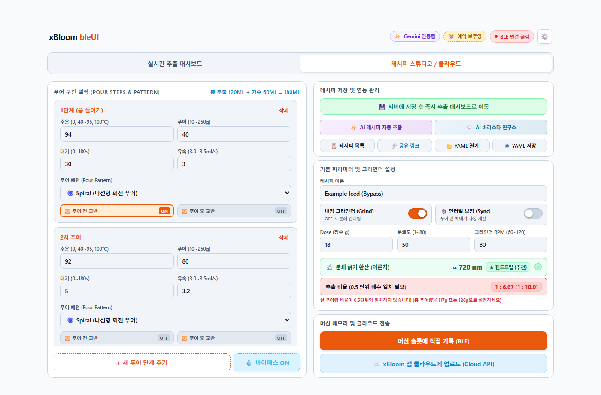
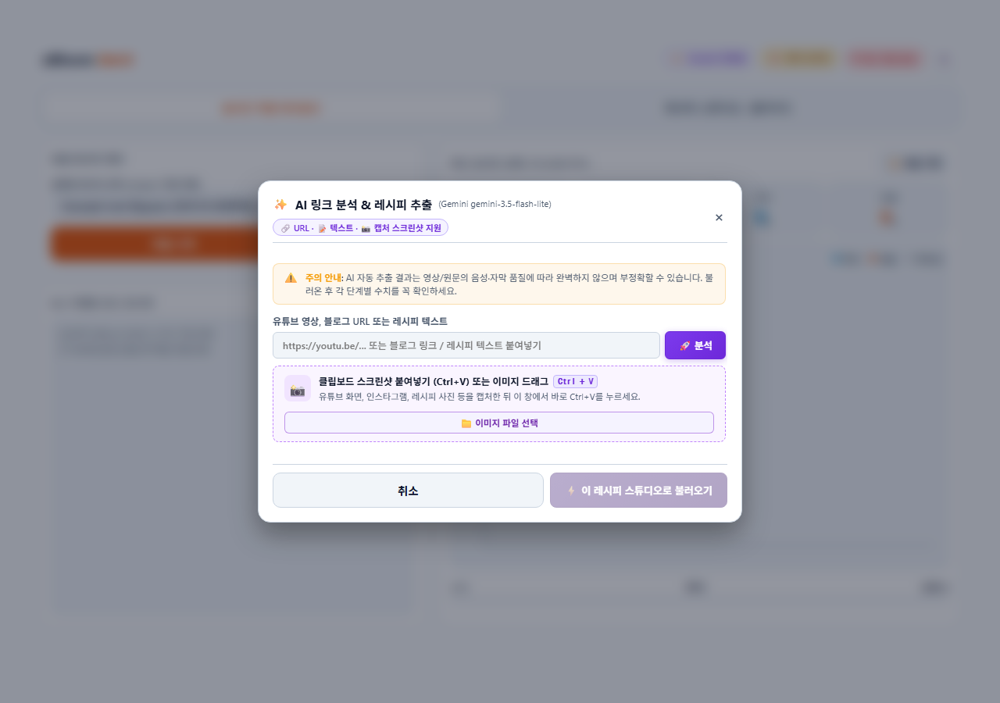
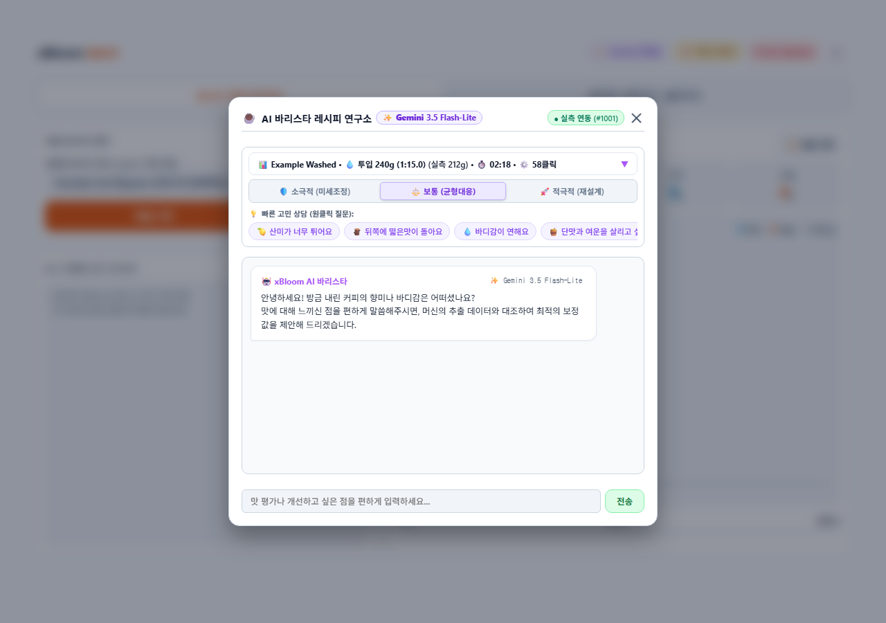
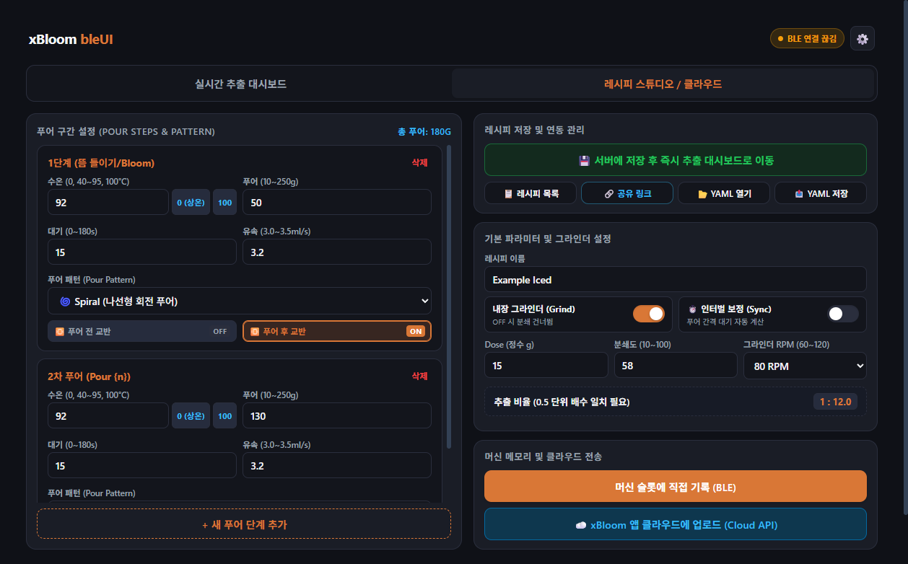
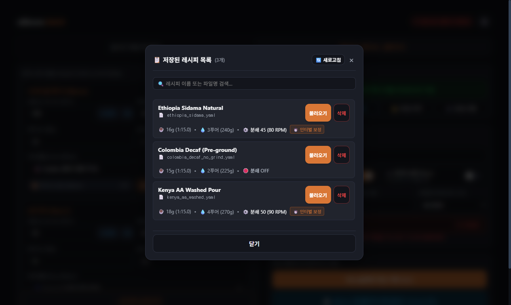
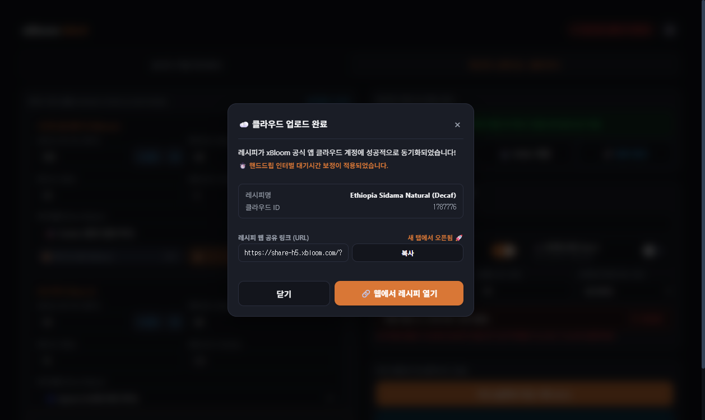
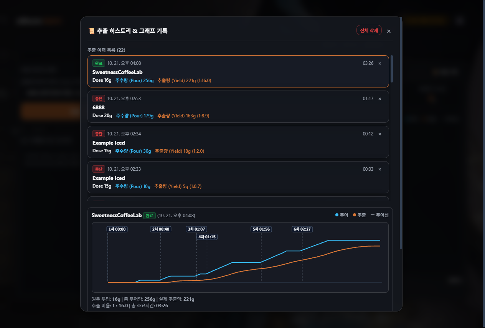

# xBloom bleUI (v1.0.1)

<p align="center">
  <strong>xBloom Studio 커피 머신을 위한 독립형 안드로이드 앱 & 로컬 웹 컨트롤러</strong>
</p>

<p align="center">
  
  
  
  
  
  
</p>

<p align="center">
  🌐 <strong>Language:</strong>
  <a href="README.md"><strong>한국어 (Korean)</strong></a> | 
  <a href="README.en.md"><strong>English</strong></a> | 
  <a href="README.ja.md"><strong>日本語</strong></a> | 
  <a href="README.zh-TW.md"><strong>繁體中文</strong></a>
</p>

<p align="center">
  
  <br>
  <em>실시간 물 투입량(Water Pour)과 컵 추출액(Coffee Yield) 듀얼 그래프 & 스마트 유속 감지 푸어 마커</em>
</p>

---

## 프로젝트 소개

**xBloom bleUI**는 프리미엄 올인원 커피 머신인 **xBloom Studio**를 블루투스(Bluetooth LE)로 연결하여, 스마트폰이나 PC에서 머신을 정밀 제어하고 실시간 추출 데이터(수온, 물 투입량, 추출액, 추출 비율)를 듀얼 그래프로 시각화해 주는 올인원 커피 컨트롤 시스템입니다.

컴퓨터 없이 스마트폰 하나로 머신을 직접 제어할 수 있는 **독립형 안드로이드 앱(APK)**을 지원하며, 원하는 시간에 맞춰 커피를 내려두는 **무인 자동 예약 브루잉**, 순수 온수만 별도로 공급하는 **바이패스(Bypass) 가수 제어**, 웹 링크와 연동되는 **AI 레시피 추출 및 바리스타 튜닝 가이드**를 제공합니다.

---

## 기여자 및 크레딧 (Contributors & Credits)

본 프로젝트는 오픈소스 커뮤니티의 기여를 바탕으로 제작되었습니다.

| 프로필 | 기여자 | 기여 및 역할 |
| :---: | :---: | :--- |
| <a href="https://github.com/Janczykkkko"></a> | **[Janczykkkko](https://github.com/Janczykkkko)** | • 원본 **[xbloom-ble](https://github.com/Janczykkkko/xbloom-ble)** 라이브러리 및 코어 BLE 통신 프로토콜 기초 구축 |
| <a href="https://github.com/ennemate"></a> | **[ennemate](https://github.com/ennemate/xBloom-bleUI)** | • **xBloom bleUI** 독립형 안드로이드 앱(APK) 및 웹 UI 개발, 예약 브루잉 및 AI 레시피 기능 구현 |

---

## 주요 기능 (Features)

### 1. 📱 독립형 안드로이드 네이티브 앱 (Standalone Android App)

<p align="center">
  
  <br>
  <em>PC 없이 스마트폰 단독으로 BLE 직결 제어가 가능한 안드로이드 네이티브 앱 화면</em>
</p>

컴퓨터를 켤 필요 없이, 스마트폰에 앱을 설치하여 머신을 직접 제어할 수 있는 정식 안드로이드 네이티브 어플리케이션(`APK`)입니다.

* **PC 완전 독립 및 BLE 직결 제어**:
  * 스마트폰 내부에 순수 자바스크립트 기반 xBloom BLE 바이너리 통신 엔진(`protocol.js`)과 모바일 로컬 백엔드를 자체 탑재했습니다.
  * 별도의 파이썬 서버나 PC 중계 없이 앱 실행 즉시 머신과 블루투스로 직결되어 실시간 추출, 레시피 편집, 머신 제어를 스마트폰 하나로 완결합니다.
* **공식 클라우드 계정 직결 연동**:
  * 스마트폰 앱 안에서 xBloom 공식 계정으로 로그인하여 나만의 클라우드 레시피를 바로 불러오거나 새 레시피를 업로드할 수 있습니다.
* **정식 개발자 서명 적용**:
  * 영구 개발자 서명 키(`bleui-release.jks`) 및 Android APK Signature Scheme v2 서명이 완료되어 신뢰성 있고 안전하게 설치할 수 있습니다.
* **모바일 최적화 반응형 UX**:
  * 스마트폰 화면 폭에 맞춘 반응형 1줄 헤더와 한눈에 들어오는 상태 뱃지, 제스처 바 간섭을 방지하는 하단 세이프에어리어 패딩을 완비했습니다.
* **데스크톱 사용자와의 조화**:
  * 큰 화면의 PC 환경을 선호하는 사용자는 Windows 포터블 무설치판이나 웹 브라우저를 통해 넓은 모니터로 대시보드와 스튜디오를 동일하게 이용할 수 있습니다.

---

### 2. ⏰ 모닝콜 연동 무인 자동 예약 브루잉 (Wake-up Scheduled Auto-Brew)

<p align="center">
  
  <br>
  <em>시간 설정 타임피커 및 모닝 브루잉 사전 준비 체크리스트</em>
</p>

바쁜 아침 원하는 시간에 맞춰 머신이 스스로 깨어나 신선한 커피를 내려두는 무인 예약 추출 파이프라인입니다.

* **스마트폰 절전(Doze 모드) 자동 해제 및 정각 기상**:
  * 스마트폰 화면이 꺼져 있거나 잠금화면 상태인 깊은 절전 모드에서도 네이티브 알람 매니저(`AlarmManager`)가 화면을 켜고 앱을 활성화하여 지정된 시각에 오차 없이 추출을 시작합니다.
  * 추출 중에는 포그라운드 상주 서비스(`BrewForegroundService`)가 가동되어 앱을 벗어나거나 화면을 꺼도 블루투스 데이터 유실 없이 실시간 기록을 완주합니다.
* **모닝 브루잉 사전 준비 체크리스트**:
  * 원두 투입, 컵 거치, 물탱크 보충 상태를 사전에 확인할 수 있는 안내 리마인더를 제공하여 안전한 무인 추출을 돕습니다.
* **1회성 안전 동작 및 히스토리 보관**:
  * 예약 활성화 시 1회성으로 정각에 단 한 번만 동작하며, 추출 완료 후에는 예약이 자동으로 정상 종료됩니다.
  * 추출 완료 시 히스토리 목록 카드에 `[⏰ 예약]` 전용 뱃지가 부여되며 실시간 추출 곡선이 영구 보관됩니다.
* **PC 환경 자동 스케줄러 지원**:
  * 데스크톱 환경에서도 로컬 서버의 백그라운드 스케줄러가 정해진 시각에 정확하게 무인 브루잉을 수행합니다.

---

### 3. 🧊 바이패스(Bypass, 가수) 제어 & 원두량(Dose) 상한 해제

<p align="center">
  
  <br>
  <em>드리퍼를 거치지 않고 온수만 직수 공급하는 바이패스 토글 및 대용량 원두 세팅 화면</em>
</p>

스페셜티 커피 레시피의 폭을 넓히기 위해 머신의 하드웨어 모터 제어 범위를 확장했습니다.

* **바이패스(Bypass) 물 공급 지원**:
  * 드리퍼 모터가 옆으로 이동하여 원두 퍽을 거치지 않고 서버로 순수 온수만 별도로 공급하는 바이패스 가수 기능이 연동되었습니다.
  * 농도 조절(클린컵 확보), 아이스 커피, 아메리카노 스타일 레시피를 레시피 스튜디오에서 자유롭게 설계할 수 있습니다.
* **원두량(Dose) 상한 해제 (20g / 40g 대용량)**:
  * 기존 18g 도징 제한을 해제하여 20g, 40g 등 2인분 및 대용량 브루잉 레시피를 온전한 추출 비율로 작성하고 머신으로 전송할 수 있습니다.

---

### 4. 🧠 지능형 AI 레시피 추출 & 실시간 AI 바리스타 연구소

<p align="center">
  
  <br>
  <em>커피 추출 영상 링크나 레시피 텍스트를 머신 파라미터로 자동 변환하는 AI 추출 모달</em>
</p>

<p align="center">
  
  <br>
  <em>실측 텔레메트리 데이터 기반 커피 맛 진단 및 원클릭 레시피 보정</em>
</p>

전문적인 커피 추출 레시피를 더 쉽고 정밀하게 다룰 수 있도록 최신 AI 기술이 결합되었습니다.

* **영상 및 웹 링크 기반 레시피 자동 추출**:
  * 커피 추출 영상 링크나 웹페이지 주소를 입력하면, AI가 음성 자막과 본문 텍스트를 분석하여 단계별 수온, 물량, 푸어 패턴, 대기시간을 레시피로 자동 변환합니다.
  * 단일 콘텐츠 안에 핫/아이스, 1인용/2인용 등 여러 레시피가 소개되어 있어도 각각 분리하여 원하는 레시피를 선택할 수 있습니다.
  * 분쇄 굵기 표기나 마이크론(µm) 수치를 xBloom 머신의 물리적 클릭 수로 정밀 계산하여 [권장 / 단맛·바디 / 클린컵·산미] 3종으로 제시합니다.
  * `[스튜디오로 불러오기]` 버튼 클릭 한 번으로 모든 파라미터가 편집기에 즉시 세팅됩니다.
* **실시간 AI 바리스타 연구소**:
  * 추출된 커피 맛을 보고 "조금 써요", "산미를 더 살리고 싶어요" 등 간단한 피드백을 전달하면 원인을 진단해 줍니다.
  * 단순 이론 제안에 그치지 않고, 방금 완료된 **실제 추출 시간, 물 투입량, 저울 수율 데이터(히스토리)**를 바탕으로 추출 편차를 분석합니다.
  * 바리스타가 제안한 레시피 보정안(분쇄도 미세 조절, 후반부 수온 인하, 푸어 간격 조정 등)을 `[원클릭 패치 적용]`으로 내 레시피에 즉시 반영할 수 있습니다.
* **최신 플래그십 AI 모델 지원**:
  * **Google Gemini 3.8 Flash** 및 **OpenAI GPT-4o** 모델을 공식 지원하며, 환경 설정에서 원하는 모델을 자유롭게 선택할 수 있습니다.
* **추출 물리 검증 완료**:
  * 원두량 증가 시 베드 수두 저항 역학, 다중 턴 다이얼링 인 수렴성 등 바리스타 의사결정 계층이 검증 스위트를 통해 사전에 철저히 검증되었습니다.

---

## 기능 비교

| 기능 영역 | 기반 통신 라이브러리 (`xbloom-ble`) | **xBloom bleUI (v1.0.1)** |
| :--- | :--- | :--- |
| **실행 플랫폼** | 터미널 기반 CLI 및 TUI (Linux 중심) | **독립형 안드로이드 네이티브 앱(APK) + 크로스플랫폼 PC 웹 대시보드** |
| **PC 의존성** | PC 파이썬 환경 필수 | **스마트폰 단독 구동 (PC 없이 스마트폰에서 BLE 직결)** |
| **자동 추출** | 미지원 | **모닝콜 연동 무인 자동 예약 브루잉 (Doze 모드 자동 기상 & 백그라운드 완주)** |
| **가수 제어** | 미지원 | **바이패스(Bypass) 물 공급 및 20g/40g 대용량 원두 지원** |
| **AI 기능** | 미지원 | **영상/웹 링크 AI 레시피 추출 & 실측 기반 AI 바리스타 연구소** |
| **추출 시각화** | 터미널 TUI 기반 실시간 텔레메트리 그래프 | **웹/앱 고해상도 Chart.js 듀얼 차트 (물 투입량 vs 커피 추출액) & 스마트 유속 마커** |
| **핸드드립 인터벌** | 기기 표준 일시정지(`wait`) 초 단위 입력 | **총 경과 시간 기준 누적 인터벌 자동 계산 & 기기 대기시간 정밀 변환** |
| **클라우드 연동** | 단방향 레시피 전송 기능 | **양방향 연동 + 공식 웹 공유 URL 발급 + 외부 공유 링크 자동 파싱** |
| **추출 데이터 보관** | 세션 실시간 모니터링 | **영구 로컬 히스토리 아카이빙, 듀얼 차트 복원, 원클릭 재추출** |
| **자동 업데이트** | 수동 git pull 또는 재설치 | **GitHub 릴리즈 연동 원클릭 자동 업데이트 (사용자 데이터 100% 무손실 보존)** |
| **다국어 (i18n)** | 영문 기반 | **글로벌 7개 언어 지원 (한국어, English, 日本語, 繁體/简体中文, Deutsch, Français)** |

---

## 주요 화면 안내

### 1. 📊 실시간 추출 대시보드
<p align="center">
  
</p>

* **실시간 수온 / 시간 / 물 투입량 / 추출액 4대 메트릭 표시**: 머신 텔레메트리 패킷을 0.1초 단위로 즉시 수신합니다.
* **듀얼 실시간 차트**: 물 투입량(Water Pour)과 컵 추출액(Coffee Yield)을 초 단위로 기록하며, 부드러운 스플라인 곡선 스무딩을 지원합니다.
* **스마트 유속/저울 푸어 마커**: 가열 지연이나 교반이 포함되어 물이 늦게 떨어지더라도, 실제 저울의 물 투입 무게가 증가하는 순간을 실시간 감지하여 차트 위에 수직 점선과 핀 배지(`1차 00:00`, `2차 00:40`...)로 표시합니다.
* **추출 비율 자동 계산**: 실시간 물 투입량과 원두량(Dose)을 기반으로 현재 추출 비율(예: `1 : 16.0`)을 실시간 갱신합니다.
* **비상 정지 안전 시스템**: 이상 감지 시 클릭 한 번으로 머신 동작을 즉시 멈추고 안전하게 연결을 보존합니다.

---

### 2. 🎛️ 레시피 스튜디오 (Recipe Studio)
<p align="center">
  
</p>

* **정밀 그라인더 제어 & 마이크론(µm) 환산 안내**: 분쇄도(1~80 클릭) 및 RPM(60~120) 제어, 분쇄도 입력 시 마이크론 크기(`≈ 808 µm` 등) 실시간 배너 제공.
* **다양한 푸어 패턴**: Center(중앙), Ring(원형), Spiral(나선형) 패턴 지원.
* **스마트 교반(Agitation)**: 푸어 전 원두 평탄화 교반(`agitation_before`) 및 푸어 후 교반(`agitation_after`) 독립 설정.
* **핸드드립 인터벌 동기화**: 목표 대기시간 대비 물 투입 소요 시간을 감안한 실제 기기 대기시간을 카드에 실시간 힌트로 표시.
* **YAML 표준 호환**: 로컬 파일로 내보내기 및 가져오기 지원.

---

### 3. 📋 저장된 레시피 관리
<p align="center">
  
</p>

* 저장된 레시피 목록을 검색하고, 즉시 불러오거나 불필요한 레시피를 삭제할 수 있습니다.
* 머신 상단의 **A, B, C 물리 버튼**에 원하는 레시피를 원격으로 즉시 플래시 메모리에 프로그래밍합니다.

---

### 4. ☁️ xBloom 클라우드 연동 & 공유 링크 자동 발급
<p align="center">
  
</p>

* 공식 앱 계정 로그인 후 클릭 한 번으로 나만의 레시피를 xBloom 클라우드에 업로드합니다.
* 업로드 즉시 공식 웹 공유 링크(`https://share-h5.xbloom.com/?id=...`)를 자동 획득하여 새 탭에서 열어보거나 복사할 수 있습니다.
* 타인이 공유한 레시피 URL을 붙여넣으면 즉시 레시피 스튜디오로 불러옵니다.

---

### 5. 📜 영구 추출 히스토리 & 그래프 아카이브
<p align="center">
  
</p>

* 완료된 추출뿐만 아니라 비상 정지된 추출 데이터까지 로컬 스토리지에 영구 보존합니다.
* 과거 추출 기록을 클릭하면 당시의 푸어선, 추출선, 푸어 마커, 소요시간, 추출 비율을 완벽 복원하여 열람할 수 있으며, **[⚡ 이 레시피 스튜디오로 불러오기]** 버튼으로 원클릭 재추출할 수 있습니다.

---

## 📦 다운로드 및 설치 (Download & Releases)

사용 환경에 맞게 배포판을 선택하여 다운로드할 수 있습니다:

| 배포판 | 대상 및 권장 환경 | 다운로드 링크 |
| :--- | :--- | :--- |
| **📱 Android 정식 릴리즈 APK**<br>*(모바일 사용자 적극 추천 ⭐)* | **PC 없이 스마트폰 단독으로 머신을 제어할 사용자**<br>• APK 파일 다운로드 후 스마트폰에서 즉시 설치<br>• 영구 개발자 서명(v2 Signature) 완료 | [⬇️ APK 다운로드 (Releases)](https://github.com/ennemate/xBloom-bleUI/releases) |
| **🚀 Windows 포터블 무설치판**<br>*(PC 사용자 추천 ⭐)* | **파이썬 설치가 번거롭거나 어려운 PC 사용자**<br>• Python 3.10 임베디드 런타임 및 필수 라이브러리 일체 내장<br>• 압축 풀고 `run.bat` 더블 클릭 즉시 구동 | [⬇️ 최신 포터블 릴리즈 다운로드 (Releases)](https://github.com/ennemate/xBloom-bleUI/releases) |
| **💻 일반 소스 배포판**<br>*(Standard / Cross-platform)* | **Windows, macOS, Linux 크로스플랫폼 지원**<br>• Python 3.10 이상이 설치된 사용자 및 개발자<br>• `git clone` 또는 Source Code ZIP 다운로드 후 직접 구동 | [⬇️ Source Code (ZIP / tar.gz)](https://github.com/ennemate/xBloom-bleUI/releases) |

---

## 빠른 시작 (Quick Start)

### 시스템 요구사항
* **모바일**: Android 8.0 (Oreo) 이상, Bluetooth BLE 지원 스마트폰
* **PC**: Windows 10/11, macOS, Linux (Bluetooth 4.2 / 5.0 이상 어댑터 필요)
* **머신**: xBloom Studio 전원이 켜져 있고 주변에 위치해야 함

---

### 방법 A. 안드로이드 스마트폰에 APK 설치 (모바일 추천)
1. 스마트폰 웹 브라우저에서 [Releases 페이지](https://github.com/ennemate/xBloom-bleUI/releases) 접속
2. **`xBloom-bleUI-release.apk`** 다운로드 및 설치
3. 앱을 실행하고 화면 우측 상단의 **[BLE 연결]** 버튼을 누르면 주변의 xBloom Studio를 자동으로 탐색하여 직결됩니다.

---

### 방법 B. Windows 포터블 무설치판 실행 (PC 추천)
1. [Releases 페이지](https://github.com/ennemate/xBloom-bleUI/releases)에서 `xBloom-bleUI-v1.0.1-Windows-Portable.zip` 다운로드
2. 원하는 폴더에 압축 해제
3. 폴더 안의 **`run.bat`** 파일을 더블 클릭
   * 내장된 임베디드 파이썬 환경으로 서버가 자동 구동되며, 기본 웹 브라우저(`http://localhost:8000`)가 즉시 열립니다.

---

### 방법 C. 일반 배포판 소스 실행 (Windows / macOS / Linux)
1. 저장소 클론 또는 소스코드 다운로드:
   ```bash
   git clone https://github.com/ennemate/xBloom-bleUI.git
   cd xBloom-bleUI
   ```
2. 필수 의존성 패키지 설치:
   ```bash
   pip install -r requirements.txt
   ```
3. 웹 서버 실행 (브라우저 자동 오픈):
   ```bash
   # 런처 스크립트 실행 (브라우저 자동 열림)
   python run.py

   # 또는 직접 uvicorn 서버 구동
   python server.py --host 0.0.0.0 --port 8000
   ```
4. 웹 브라우저에서 `http://localhost:8000` 접속

---

### 🔄 버전 업데이트 및 사용자 데이터 보존 안내 (Data Safe Update)

* **원클릭 자동 업데이트**: 웹 화면 상단의 업데이트 알림 뱃지 또는 설정(⚙️)의 [업데이트 확인]을 통해 안전하게 최신 버전으로 업그레이드할 수 있습니다.
* **사용자 데이터 100% 무손실 보존**:
  * 업데이트 시 소스 코드와 정적 UI 파일만 선별 교체되므로, 다음 사용자 데이터는 **절대 덮어씌워지지 않고 안전하게 보존**됩니다:
    * 📂 `recipes/` (나만의 작성 레시피 및 슬롯 프리셋)
    * 📄 `history.json` (과거 모든 추출 기록 및 듀얼 차트 아카이브)
    * ⚙️ `config.json` (테마, 배경화면, 클라우드 계정 설정)
    * 🐍 `python/` (포터블 에디션 내장 런타임)
